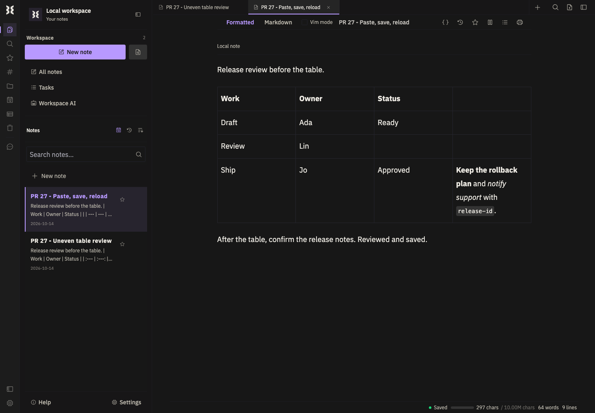
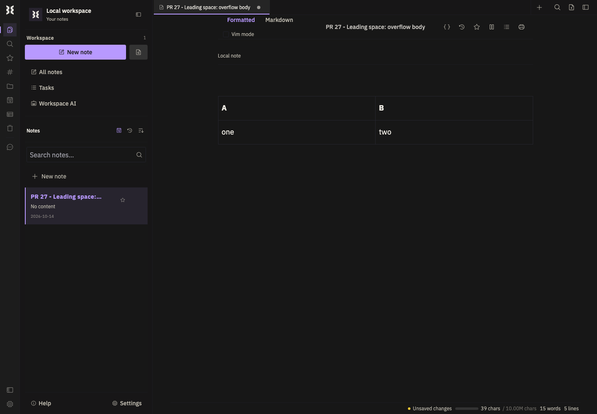
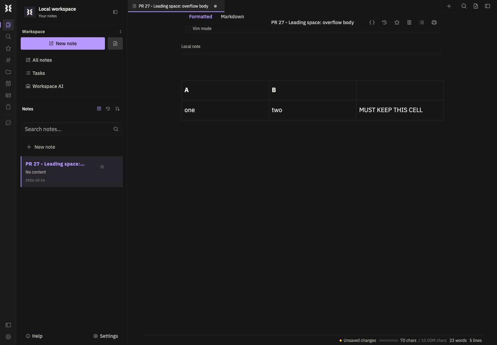

# PR 27 review evidence

Reviewed feature commit: `939105f320ffe59323de8263df657786a9e45820`.

Verdict: **Leading-space finding resolved; local regressions pass**. See PR checks for the current commit's merge eligibility.

## Walkthrough

[Watch the browser recording](./walkthrough.mp4) (1440 x 1000, approximately 24 seconds).

The recording shows the original uneven Markdown, its formatted rendering, pasting into another note, editing, saving with Cmd+S, and reloading. Assertions verify four columns, padded short rows, the overflow cell's bold/italic/code formatting, surrounding prose, and saved text after reload. Clipboard input uses a synthetic plain-text paste event through the editor's real paste handler; system clipboard integration is outside this test.



## Original finding: P2 - leading indentation breaks table repair

[`markdown-table.ts:42-46`](https://github.com/g4rcez/writeme-editor/blob/939105f320ffe59323de8263df657786a9e45820/packages/editor/src/lib/markdown-table.ts#L42-L46) slices the original matched source using the lengths of capture groups that exclude leading spaces. A leading space on the header or delimiter therefore offsets the suffix incorrectly and produces an invalid normalized delimiter. The custom tokenizer falls back to Marked, which either renders the table as prose or discards overflow cells.

Reproduced through the browser editor's plain-text paste handler with this input. There is one leading space on the first line:

```markdown
 | A | B |
| --- | --- |
| one | two | MUST KEEP THIS CELL |
```

Expected: three columns, with `MUST KEEP THIS CELL` retained. Observed: two columns, with that text missing. Using a three-column delimiter instead renders the entire table as raw Markdown. Direct tokenizer checks also reproduce the problem with one, two, and three spaces.



## Resolution

The [table tokenizer](../../../packages/editor/src/lib/markdown-table.ts) now locates the second newline in the original match to retain the correct body suffix. Indentation no longer corrupts the normalized delimiter, and uneven empty tables also work without a final newline.

The original two browser reproductions now pass. The parser covers one, two, and three leading spaces on the header, delimiter, or both. The browser matrix covers unindented, header-indented, delimiter-indented, and both-indented tables, each opened and pasted in normal and large notes, then saved and reloaded. CI runs this matrix on Windows, macOS, and Linux and checks the new code's lint and TypeScript diagnostics.

[Watch the fixed leading-space reproduction](./leading-space-fixed.mp4).



## Validation

| Check | Result |
| --- | --- |
| Browser matrix: normal/large opening and pasting, indentation variants, save/reload | 16 passed |
| Original indented mismatched delimiter and overflow-body browser reproductions | 2 passed after the fix |
| Table parser, Markdown integration, worker unit tests | 59 passed |
| Full root unit suite | 190 files passed; 1,516 tests passed; one existing test skipped |
| Root TypeScript check | Passed |
| Changed code lint and browser test TypeScript check | Passed |

Commands:

```sh
npm run test:e2e -- --platform osx --suite browser --project=chromium --grep 'markdown table cells'
npm test -- --run packages/editor/src/lib/markdown-table.test.ts packages/editor/src/lib/markdown-worker/markdown.worker.test.ts packages/editor/src/app/extensions/tiptap-markdown/Markdown.test.ts
npm run typecheck
NODE_OPTIONS=--no-experimental-webstorage npm test
```

The local shell runs Node 26; disabling its experimental Node web-storage globals lets jsdom supply browser storage during the full unit run. CI uses the repository's pinned Node 24.18.0 and runs `npm test` normally.

Browser evidence comes from desktop Chromium on macOS using the repository's Vite/Playwright browser runner. It does not establish native Electron or physical-device behavior. Existing development-server warnings, including duplicate React keys and a transient module fetch error, appeared during the passing run; they were not repaired or attributed to this PR.
